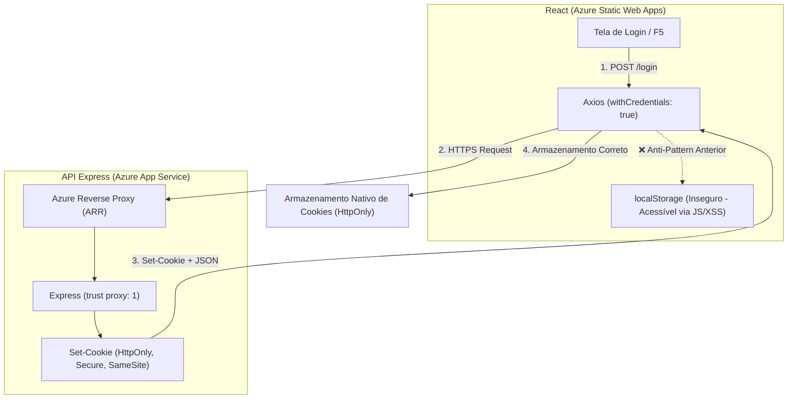

<!-- Documento: docs/GUIA-DEPLOY-AZURE-COOKIES.md -->

# 🔐 Guia Definitivo: Autenticação Segura com Cookies HttpOnly e Deploy no Azure (React + Express)

[← Voltar ao Índice](../README.md) · [Contrato da API](CONTRATO-DA-API.md) · [Serviços e Tipagens](03-servicos-e-tipagens.md) · [Contexto de Autenticação](05-contexto-de-autenticacao.md)

---

## 📌 Sumário Executivo

Ao publicar uma aplicação web composta por **Front-end em React (Azure Static Web Apps)** e **Back-end em Express (Azure App Service)**, é comum se deparar com a seguinte situação:

> *"Após realizar o deploy na nuvem, percebi que o token JWT não estava funcionando como cookie `HttpOnly`, mas continuava sendo gravado dentro do `localStorage` do navegador."*

Este guia técnico detalha a **causa raiz** dessa ocorrência, as **vulnerabilidades de segurança** de persistir credenciais no `localStorage`, as **diferenças de arquitetura entre ambientes locais e na nuvem**, as **alterações aplicadas no código** e as **soluções definitivas no Azure**.

---

## 🔍 1. Diagnóstico do Problema: Por que isso aconteceu?

O problema observado resulta da convergência de **cinco fatores técnicos**:



### Fator 1: O código do Front-end salvava o token manualmente no `localStorage`
No componente de contexto (`src/context/AuthContext.tsx`), o método `login()` recebia a resposta da API e executava:
```typescript
// ❌ CÓDIGO ANTERIOR INSEGURO:
const { token: receivedToken, user: loggedUser } = response.data;
if (receivedToken) {
  localStorage.setItem('token', receivedToken); // Gravava no localStorage!
}
```
Além disso, em `src/services/api.ts`, havia um interceptor do Axios que buscava o token no `localStorage` e o inseria manualmente no cabeçalho `Authorization: Bearer <token>`. Isso fazia com que a aplicação operasse baseada no `localStorage`, ignorando o mecanismo de cookies.

### Fator 2: A barreira Cross-Domain e Public Suffix List no Azure
Em ambiente de desenvolvimento local, tanto o front-end quanto o back-end rodam em `localhost` (ex: `localhost:5173` e `localhost:3000`). Nesse cenário, os cookies operam sob o mesmo domínio base.

Na nuvem Azure, os serviços recebem domínios padrão distintos:
- **Front-end (Static Web Apps):** `https://<nome-do-app>.azurestaticapps.net`
- **Back-end (App Service):** `https://<nome-da-api>.azurewebsites.net`

Tanto `azurestaticapps.net` quanto `azurewebsites.net` estão registrados na **Public Suffix List (PSL)**. Isso significa que, do ponto de vista de segurança dos navegadores, eles são **sites completamente diferentes (Cross-Site / Third-Party Context)**.

### Fator 3: Política `SameSite` e bloqueio de Cookies de Terceiros
- Um cookie emitido com `SameSite=Lax` é rejeitado pelos navegadores em requisições assíncronas (AJAX / Axios / Fetch) originadas de um site diferente.
- Para requisições cross-site funcionarem, o cookie precisa obrigatoriamente de `SameSite=None` **e** `Secure=true`.
- Adicionalmente, navegadores modernos (como Safari com ITP, Brave com Shields e versões recentes do Google Chrome) bloqueiam ou particionam cookies de terceiros por padrão, a menos que o front-end e o back-end compartilhem a mesma origem ou usem a vinculação nativa de backend.

### Fator 4: Ausência de `trust proxy` no Express atrás do Azure ARR
No Azure App Service, a conexão TLS/HTTPS é terminada no balanceador/proxy reverso da Microsoft (ARR). O tráfego interno chega ao Node.js via HTTP. Sem a instrução:
```typescript
app.set('trust proxy', 1);
```
O Express não reconhece que a requisição original do cliente era HTTPS (`req.secure === false`), o que impede a emissão segura de cookies e afeta a validação de protocolos.

### Fator 5: Validação estrita de Origem no Back-end
No arquivo `auth.middleware.ts`, requisições com mutação de estado (POST/PUT/DELETE) autenticadas por cookie exigiam que o cabeçalho `Origin` estivesse em uma lista estática (`allowed.includes(origin)`), bloqueando origens dinâmicas do Static Web Apps (como URLs de preview `.5.azurestaticapps.net`).

---

## 🛡️ 2. Segurança: `HttpOnly Cookie` vs `LocalStorage`

A tabela abaixo compara os dois modelos de armazenamento de credenciais:

| Critério | `localStorage` | `HttpOnly Cookie` (Recomendado) |
|---|---|---|
| **Acesso via JavaScript (`document.cookie` / `window.localStorage`)** | **Sim (Acesso Total)** 🚨 | **Não (Inacessível por scripts)** 🔒 |
| **Proteção contra Ataques XSS (Cross-Site Scripting)** | **Nenhuma.** Se um script malicioso for injetado, ele rouba o JWT imediatamente. | **Alta.** O JavaScript injetado não consegue ler o cookie `HttpOnly`. |
| **Envio automático pelo navegador** | Não (exige interceptor de requisição no código). | **Sim** (o navegador envia automaticamente com `withCredentials: true`). |
| **Exposição no DevTools (F12)** | Legível em texto claro na aba *Local Storage*. | Protegido na aba *Cookies* com a flag `HttpOnly` marcada. |
| **Controle de Expiração** | Manual via código. | Gerenciado nativamente pelo navegador via atributo `Max-Age` / `Expires`. |

> [!IMPORTANT]
> **Regra de Ouro:** Tokens de autenticação JWT em aplicações para navegador nunca devem ser armazenados em `localStorage` ou `sessionStorage`. O padrão correto é mantê-los exclusivamente dentro de cookies protegidos com as flags `HttpOnly`, `Secure` e `SameSite`.

---

## 🛠️ 3. Ajustes Implementados no Código

Para corrigir o comportamento e garantir a conformidade com as melhores práticas, as seguintes alterações foram realizadas:

### 1. Front-end: `React-App/src/context/AuthContext.tsx`
- **Remoção total de `localStorage` para tokens:** O método `login()` não armazena mais `receivedToken` no `localStorage`.
- **Restauração de Sessão Segura (`useEffect`):** Ao recarregar a página (F5), a aplicação consulta o endpoint autenticado `GET /users` enviando automaticamente o cookie `HttpOnly`. Se o cookie for válido, a sessão é restaurada com os dados e o perfil (`role`) do usuário.
- **Higienização Preventiva:** O código remove automaticamente qualquer token remanescente de versões antigas do `localStorage`.
- **Logout Seguro:** O método `logout()` invoca o endpoint `POST /logout` da API, permitindo que o servidor limpe o cookie no navegador via cabeçalho `Set-Cookie`.

```typescript
// Trecho corrigido em React-App/src/context/AuthContext.tsx:
const login = async (credentials: LoginCredentials): Promise<User> => {
  const response = await api.post<LoginResponse>('/login', credentials);
  const { user: loggedUser } = response.data;

  // Higieniza o localStorage: credenciais nunca devem residir em storage de script
  localStorage.removeItem('token');
  localStorage.removeItem('user');

  setUser(loggedUser);
  return loggedUser;
};
```

### 2. Front-end: `React-App/src/services/api.ts`
- O interceptor de requisição que lia o `token` do `localStorage` e inseria o cabeçalho `Authorization: Bearer` foi **removido**.
- Mantida a configuração essencial:
```typescript
export const api = axios.create({
  baseURL: API_BASE_URL,
  withCredentials: true, // Garante o transporte do cookie HttpOnly
  timeout: 10000,
});
```

### 3. Front-end: `React-App/public/staticwebapp.config.json` e raiz
- Configurado o roteamento de SPA (*Single Page Application*) e o cabeçalho de Content Security Policy (CSP):
```json
{
  "navigationFallback": {
    "rewrite": "/index.html",
    "exclude": ["/assets/*", "/*.{png,jpg,gif,ico,svg}"]
  },
  "responseOverrides": {
    "404": {
      "rewrite": "/index.html",
      "statusCode": 200
    }
  },
  "globalHeaders": {
    "content-security-policy": "default-src 'self' https: data: 'unsafe-inline' 'unsafe-eval'"
  }
}
```

### 4. Back-end: `express.js_API/src/app.ts`
- Inclusão da diretiva `trust proxy`:
```typescript
export const app = express();
app.set('trust proxy', 1); // Indispensável para Azure App Service
```

### 5. Back-end: `express.js_API/src/middlewares/auth.middleware.ts`
- Atualização da validação de origem para suportar subdomínios dinâmicos do Azure Static Web Apps:
```typescript
if (authorization === undefined && unsafe) {
  const origin = req.get('origin');
  if (!origin || !isOriginAllowed(origin)) {
    res.status(403).json({ error: 'Origem obrigatória e confiável para autenticação por cookie.' });
    return;
  }
}
```

### 6. Back-end: `express.js_API/src/controllers/auth.controller.ts`
- Emissão do cookie com parâmetros dinâmicos:
```typescript
const isProduction = env.NODE_ENV === 'production';

const cookieOptions = {
  httpOnly: true,
  secure: isProduction,
  sameSite: isProduction ? ('none' as const) : ('lax' as const),
  path: '/',
};

export const login = async (req: Request, res: Response) => {
  const result = await AuthService.login(req.body);
  res.cookie('token', result.token, { ...cookieOptions, maxAge: 15 * 60 * 1000 });
  res.json(result);
};
```

---

## 🚀 4. As Duas Estratégias de Deploy no Azure

Existem dois caminhos arquiteturais para operar com cookies no Azure:

### Estratégia A: Backend Vinculado no Azure Static Web Apps (Recomendada)

Nesta estratégia, o Azure Static Web Apps roteia automaticamente as chamadas da URL `/api/*` diretamente para o seu Azure App Service.

```mermaid
sequenceDiagram
    autonumber
    actor Aluno as Usuário (Navegador)
    participant SWA as Azure Static Web Apps (app.azurestaticapps.net)
    participant AppService as Azure App Service (expresst13.azurewebsites.net)

    Aluno->>SWA: POST /api/login (credenciais)
    Note over SWA,AppService: Roteamento interno transparente (Mesma Origem)
    SWA->>AppService: Repassa requisição
    AppService-->>SWA: Set-Cookie: token=...; HttpOnly; SameSite=Lax
    SWA-->>Aluno: Resposta 200 OK + Cookie First-Party
    Note over Aluno: O navegador armazena o cookie como First-Party nativo. Nenhum browser bloqueia!
```

#### Vantagens da Estratégia A:
1. **Cookie First-Party (Mesmo Domínio):** Não há restrições de terceiros. Funciona no Safari, Chrome, Edge e Brave sem ressalvas.
2. **`SameSite=Lax`:** Não necessita de `SameSite=None`.
3. **Zero complexidade com CORS:** O tráfego do front-end e da API passa pela mesma origem.

#### Como configurar no Portal do Azure:
1. Acesse o seu recurso **Azure Static Web Apps**.
2. No menu lateral, acesse **Configurações** ➔ **Back-ends vinculados (Linked backends)**.
3. Clique em **Vincular** e selecione o tipo de recurso **Serviço de Aplicativo (App Service)**.
4. Selecione a sua API Express (`expresst13-...`).
5. No front-end React, configure a variável de ambiente:
   ```env
   VITE_API_URL=/api
   ```

---

### Estratégia B: Comunicação Direta Cross-Origin (HTTPS Cross-Site)

Caso a aplicação utilize comunicação direta entre os domínios `azurestaticapps.net` e `azurewebsites.net`:

#### Configuração das Variáveis no Azure App Service:
No Portal do Azure (**App Service ➔ Configuração ➔ Configurações do Aplicativo**):
- `NODE_ENV`: `production`
- `FRONTEND_ORIGIN`: `https://<seu-app>.azurestaticapps.net`
- `API_ORIGIN`: `https://expresst13-gtazeuceene4a2d4.canadacentral-01.azurewebsites.net`
- `JWT_SECRET`: *(chave segura de 32+ caracteres)*
- `DATABASE_URL`: `postgresql://...`

#### Configuração no React (`.env.production`):
```env
VITE_API_URL=https://expresst13-gtazeuceene4a2d4.canadacentral-01.azurewebsites.net
```

---

## 🧪 5. Roteiro de Verificação e Evidências no Navegador

Após os ajustes, execute o passo a passo a seguir para auditar o comportamento da aplicação:

### Passo 1: Limpar o estado anterior
1. Abra a aplicação no navegador (local ou no Azure).
2. Pressione `F12` para abrir o **DevTools**.
3. Acesse a aba **Application** (ou **Aplicativo**):
   - Em **Storage ➔ Local Storage**, confira se a chave `token` foi removida.
   - Em **Storage ➔ Cookies**, limpe os cookies existentes para iniciar um teste limpo.

### Passo 2: Efetuar Login
1. Realize o login com uma conta de Aluno ou Professor.
2. Observe na aba **Network (Rede)** a requisição `POST /login`:
   - Cabeçalho de resposta: deve conter `Set-Cookie: token=...; Path=/; HttpOnly; ...`
3. Retorne à aba **Application ➔ Storage ➔ Cookies**:
   - O cookie `token` estará listado.
   - A coluna **HttpOnly** estará com uma marcação ativa (✔️).
   - O valor **NÃO** poderá ser lido por nenhum script no console (`document.cookie` retornará vazio para o token).
4. Inspecione **Application ➔ Storage ➔ Local Storage**:
   - **Confirmação de Sucesso:** Não existe nenhum item com chave `token` gravado no Local Storage.

### Passo 3: Testar a Persistência de Sessão com `F5`
1. Estando autenticado em `/aluno` ou `/professor`, recarregue a página (`F5`).
2. Observe na aba **Network**:
   - A aplicação executa uma chamada `GET /users`.
   - O cabeçalho da requisição inclui automaticamente `Cookie: token=...`.
   - A API valida o cookie e retorna `200 OK` com os dados do usuário.
   - O usuário permanece logado e o guardião de rotas mantém o acesso sem redirecionar para o login.

### Passo 4: Testar o Logout
1. Clique no botão **"Sair"**.
2. A aplicação executa `POST /logout`.
3. O servidor emite um cabeçalho `Set-Cookie` com expiração no passado (`Max-Age=0`).
4. O navegador deleta o cookie imediatamente e redireciona o usuário para `/login`.

